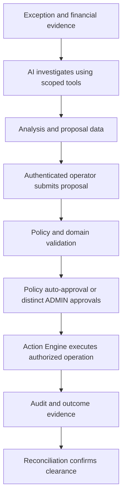

# AI agents and execution boundaries

LedgerMind is a learning project using synthetic data and optional provider test calls. The [behavior contract](docs/architecture/behavior-contract.md) defines shared rules, the [PRD](docs/product/prd.md) defines product and approval requirements, and the [verification record](docs/operations/fix-verification.md) records tested cases. The [historical audit](docs/operations/full-code-audit-2026-10-21.md) describes earlier defects.

## AI Finance Controller

The AI Finance Controller investigates exceptions, explains discrepancies, answers questions, and proposes actions. It consumes merchant-scoped financial facts and returns analysis, evidence references, uncertainty, and proposed next steps.

Its tools are implemented in the NestJS AI service. The current catalogue has 16 tools: 13 discovery/advisory functions and three proposal functions. The [AI specification](docs/specifications/ai-agent.md#current-tool-catalogue) lists their names and purposes.

request_refund, create_payment_link, and mark_for_review return proposal data. They do not persist actions, call the Action Engine, or execute provider writes. An authenticated FINANCE or ADMIN operator submits a proposal separately.

## Deterministic policy and audit

| Component | Responsibility |
| --- | --- |
| PolicyService | Evaluates action type, role, amount, and required approval count. It is deterministic code, not an LLM. |
| Action Engine | Validates scoped targets and current eligibility, reserves capacity, enforces distinct approvals, and executes authorized local/simulated/test operations. |
| Audit persistence | Records required AI responses and action decisions/outcomes through Prisma. It is part of the application, not an independent AI agent. |

Required audit writes participate in the relevant database transaction. An audit failure must not silently produce a successful persisted analysis or action completion.

## Interaction flow

AI confidence is advisory. It does not replace authorization, financial evidence, or required human approvals. A provider response and exception clearance are separate facts.

## Model configuration

The application uses Groq's OpenAI-compatible endpoint, https://api.groq.com/openai/v1. AI_ENABLED defaults to false through application configuration. Enabling provider calls requires a valid GROQ_API_KEY. AI_MODEL defaults to llama-3.3-70b-versatile and can be overridden explicitly; Compose uses the same fallback.

Tool definitions use OpenAI-style JSON schemas. The backend validates tool names and arguments, runs the allowed NestJS methods, and validates the final analysis before persistence. See [local setup](docs/operations/local-development.md#optional-groq-setup) for configuration and [testing](docs/operations/testing.md#optional-provider-checks) for optional connectivity checks.

## Evaluation and status

Evaluate root-cause accuracy against labeled synthetic cases, explanation clarity, evidence quality, safe proposal boundaries, and measured latency. A simple-query target below two seconds remains an unverified benchmark rather than a service guarantee.

Use the [backlog](TODO.md) for optional exercises and the [verification record](docs/operations/fix-verification.md#verification-boundaries-and-remaining-learning-work) for evidence limits.
