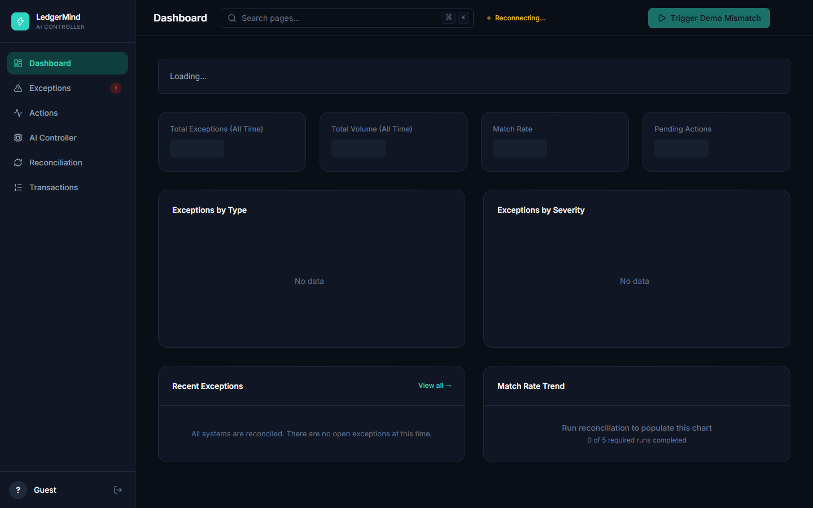
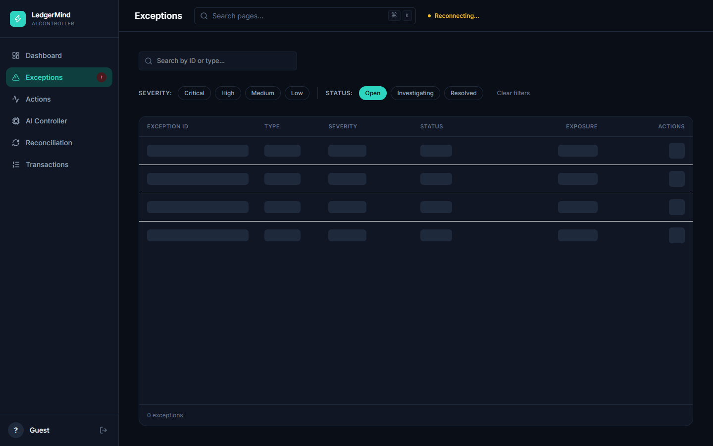

# LedgerMind

LedgerMind is a learning project for financial reconciliation, reliable event processing, and AI-assisted investigation. It uses synthetic records, an explicit payment simulator, and optional provider test calls.

The core rule is simple: deterministic code reconciles financial facts, AI explains them, and the Action Engine enforces authorization before execution.

## Start here

1. Follow the [local setup](docs/operations/local-development.md) to configure Node, PostgreSQL, Redis, and environment files.
2. Initialize a disposable learning database, sign in, and run reconciliation to create exceptions.
3. Read the [behavior contract](docs/architecture/behavior-contract.md) alongside the code.
4. Use the [testing guide](docs/operations/testing.md) to reproduce and verify changes.

Existing private environment files and learning records should be preserved. Seeding is an explicitly confirmed destructive operation; ordinary restarts preserve records.

## What the application does

| Area | Implemented behavior |
| --- | --- |
| Reconciliation | Compares orders, captures, refunds, allocated settlements, and posted bank evidence; maintains exception facts and lifecycle. |
| Webhooks | Verifies original-byte signatures, persists events, recovers dispatch gaps, and processes owned retryable claims. |
| Investigation | Provides scoped financial evidence, optional Groq analysis/chat, and advisory action proposals. |
| Actions | Validates targets, reserves refundable capacity, records distinct approvals, and tracks uncertain external outcomes. |
| Console | Offers dashboard, transactions, exceptions, AI Controller, actions, reconciliation, and audit views. |
| Verification | Includes unit, HTTP, PostgreSQL/Redis, browser, packaging, and documentation checks. |

AI proposal tools do not insert or execute actions. An authenticated operator submits a proposal; policy and domain validation decide whether it can proceed. Provider acceptance alone does not resolve an exception.

## Preview

<picture>
  <source media="(prefers-color-scheme: dark)" srcset="docs/assets/dashboard-dark.png">
  
</picture>
<picture>
  <source media="(prefers-color-scheme: dark)" srcset="docs/assets/investigation-dark.png">
  
</picture>

These are earlier demonstration screenshots. Their labels and totals may differ from the current application; they are not evidence of current reconciliation results. The source and interface references define current behavior.

## Technology and layout

| Location | Purpose |
| --- | --- |
| backend/src | NestJS API, domain services, provider adapters, and BullMQ workers. |
| backend/prisma | PostgreSQL schema, synthetic seed, and reviewed one-time upgrade SQL. |
| backend/test | Guarded HTTP/security E2E suites. |
| frontend | Next.js 16 App Router, React, TypeScript, Tailwind CSS, SWR, and Recharts. |
| scripts | Runtime setup and maintained verification tools. |
| docs | Architecture, product, interface, setup, and verification references. |

The root package-lock.json is canonical for both npm workspaces. The project pins Node 22.23.4 locally; Docker and CI use Node 22. Supported engine ranges are declared in the package manifests.

## Development commands

Run these from the repository root after completing setup:

```powershell
npm run npm -- ci
npm run dev:backend
npm run dev:frontend
```

Start the two development commands in separate terminals. The default frontend is http://localhost:3000; the backend base path is http://localhost:3001/api/v1. The browser defaults to /api, which Next.js proxies to the backend. Compose publishes PostgreSQL on loopback port 5432 and Redis on loopback port 6380.

Root .env configures Compose, backend/.env configures local API commands, and frontend/.env.local configures Next.js. The tracked root template selects `PAYMENT_EXECUTION_MODE=simulation` for learning and disables AI. Without that setting, application and Compose payment execution default to `disabled`. Check the selected mode before starting; copying the template opts into simulated payment actions.

## Status and learning work

The [verification record](docs/operations/fix-verification.md) records passing cases for the 58 original findings, R1-R11, and Q1-Q6. Finding 44 was withdrawn and is excluded from the original total. The latest full application verification is dated 24 October 2026; documentation editing does not constitute a new runtime test run.

See [TODO.md](TODO.md) for optional learning exercises and [the documentation index](docs/README.md) for the full reading path.

No LICENSE file is currently included in this repository.
