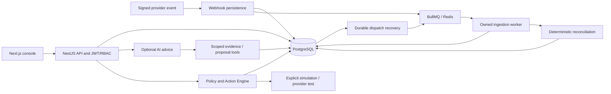
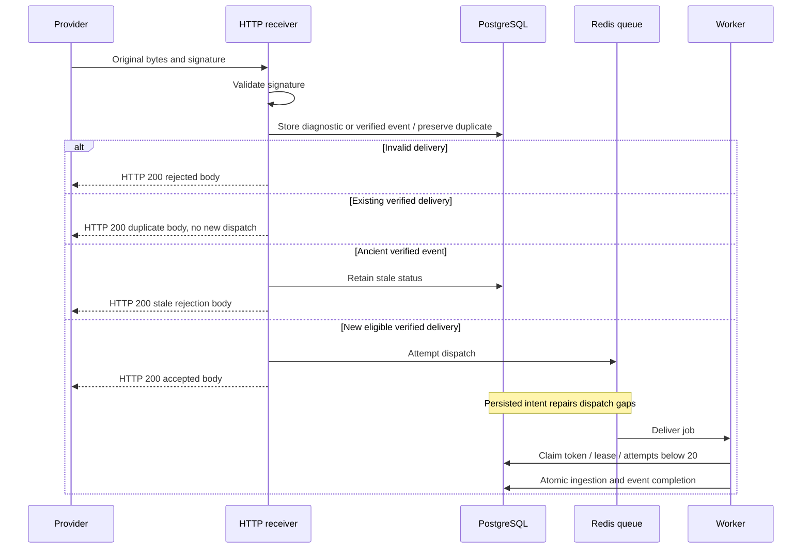
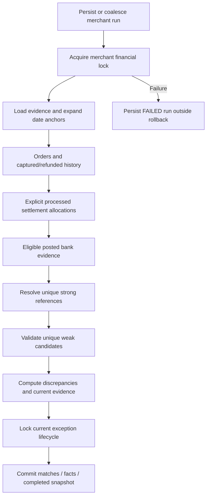
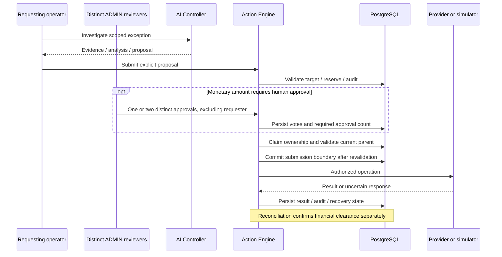
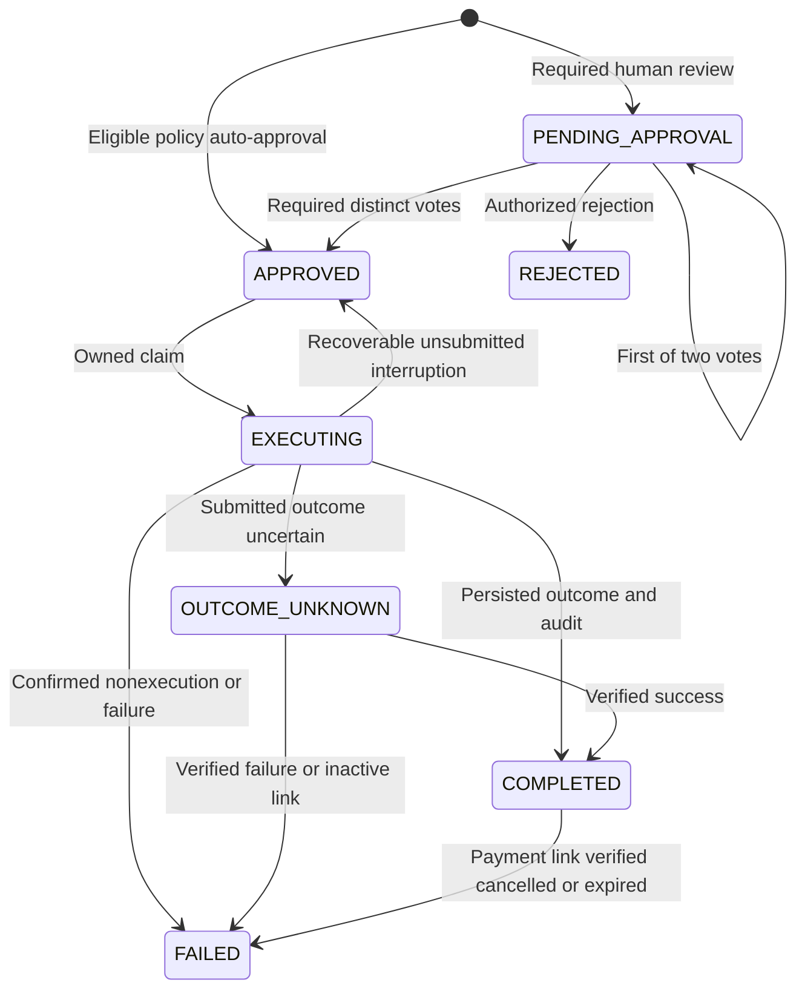
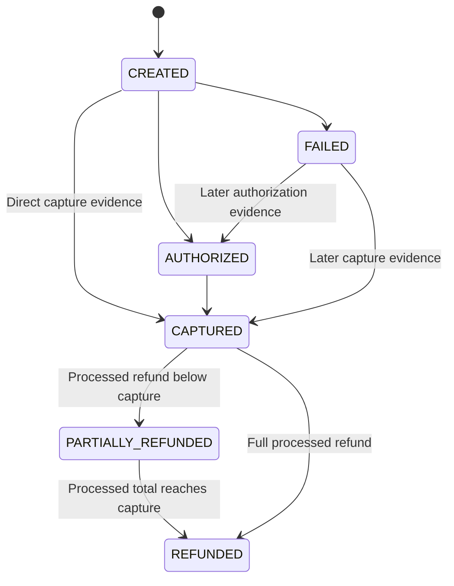
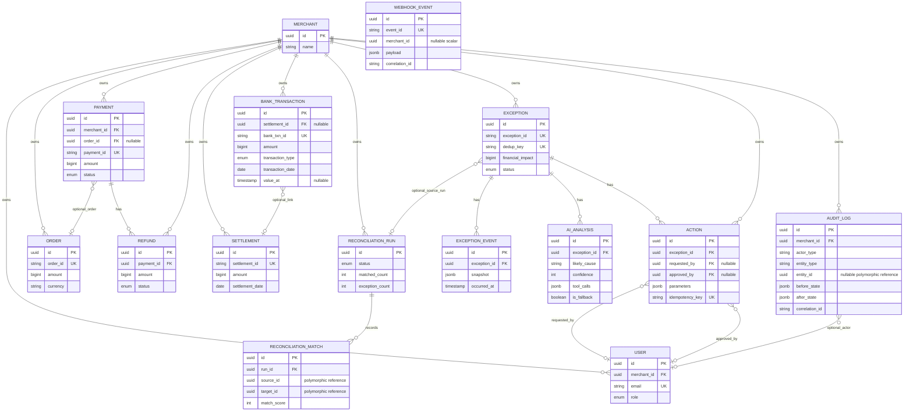
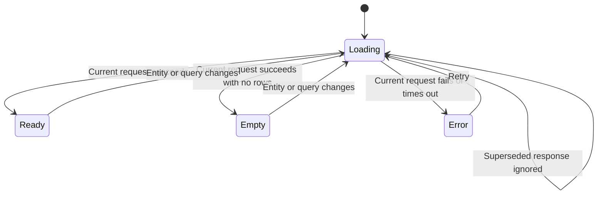

# Architecture diagrams

These diagrams summarize implemented flows and their boundaries. The [behavior contract](behavior-contract.md) defines the rules, the [architecture guide](overview.md) explains the design, and the [verification record](../operations/fix-verification.md) records tested cases. Mermaid structure is checked offline; rendered layout still needs a compatible viewer.

## System architecture

The AI tools have no execution edge to the Action Engine. Operator submission supplies the separate authorized request.

## Webhook ingestion

A database failure is not an accepted delivery. Queue failure after durable persistence is recoverable. Acceptance does not imply successful processing or reconciliation.

## Reconciliation evidence

Amounts, currency, state, deadlines, allocation conservation, and reference compatibility are checked after relationships are resolved. Only the evaluated scope may be cleared.

## Proposal, approval, and execution

This sequence shows monetary actions. Small eligible amounts use policy auto-approval after operator submission; larger amounts require the distinct reviewers shown above. Local MARK_REVIEWED/ESCALATE actions do not call a provider. If the parent becomes terminal before monetary submission, execution records known nonexecution. A late result after submission preserves current terminal parent decisions.

## Action states

The final transition applies only to confirmed inactive payment links and retains provider evidence. Unknown financial outcomes are protected and cannot be automatically resubmitted.

ADMIN provider verification requires provider_test mode; the lookup is unavailable in simulation/disabled mode. A FAILED result on that final link transition means the provider confirmed an inactive link, not that the original creation never succeeded.

## Payment evidence states

These are selected transitions implemented by ingestion and refund writers, not a complete provider state graph. The ingester retains AUTHORIZED when a later payment.failed event arrives, so no AUTHORIZED-to-FAILED edge is shown. Later valid authorization/capture evidence can replace a previously FAILED state. Delayed authorization/failure cannot erase captured/refunded evidence. Capture history remains relevant after refund. Settlement membership is a relationship rather than an additional PaymentStatus.

## Data model

Selected current relations and columns are shown below. The [database reference](../specifications/database.md) lists all 17 models. Polymorphic match/timeline/audit references remain service-validated links.

## Browser request lifecycle

Freshness follows successful manual/SWR requests. Investigation timeout allows retry. Mutation controls reflect the current entity and actual action status. Frontend error handling is described in [testing and troubleshooting](../operations/testing.md#error-handling-and-troubleshooting).

## Frontend implementation references

The current theme sources are [tokens.ts](../../frontend/lib/tokens.ts) and [globals.css](../../frontend/app/globals.css). Components are custom React/Tailwind; charts use Recharts. Integer-paise formatting is shared through [utils.ts](../../frontend/lib/utils.ts) and Amount components. Counts, ratios, severity, and money retain separate display semantics.

Browser routes include the dashboard at / and audit at /audit. See the [product scope](../product/prd.md#scope-and-status) for current limits.
